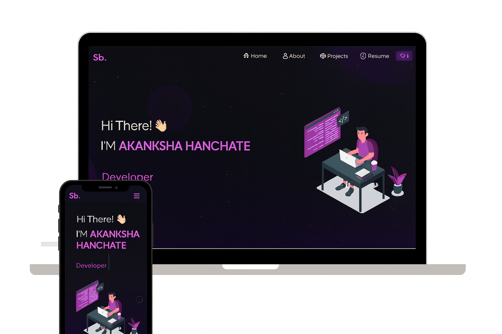

# 👩‍💻 Aparnaa A S | Personal Portfolio Website

Welcome to my personal portfolio repository ✨  
This project represents my journey as a **Computer Science student**, highlighting my skills, projects, blogs, and continuous learning in technology.

The portfolio is designed to be **clean, modern, responsive**, and easy to navigate across all devices.

---

## 🖼 Portfolio Preview

<div align="center">
  
</div>

---

## 📖 About This Portfolio

This portfolio website serves as a single place to showcase:

- My academic background in Computer Science  
- Personal and academic projects  
- Blogs focused on learning, problem-solving, and growth  
- Technical skills and tools I work with  
- Resume and contact information  

The goal of this project is not just to display work, but to **communicate my thought process, curiosity, and passion for technology**.

---

## 💻 Sections Included

- **Home** – Introduction and role overview  
- **About** – Education, interests, and strengths  
- **Projects** – Selected projects with descriptions and outcomes  
- **Blogs** – Articles on learning experiences and technical insights  
- **Resume** – Downloadable resume  
- **Contact** – Social and professional links  

---

## 🧰 Tech Stack Used

| Category | Technologies |
|-------|-------------|
| Frontend | React.js, JavaScript (ES6+) |
| UI & Styling | CSS3, React-Bootstrap |
| Routing | React Router |
| Version Control | Git, GitHub |
| Development Tools | VS Code |
| Deployment | Vercel |

---

## ✨ Key Features

- ✅ Multi-page React application  
- ✅ Fully responsive (desktop, tablet & mobile)  
- ✅ Clean UI with dark theme  
- ✅ Blog section with dynamic routing  
- ✅ Easy-to-customize component structure  
- ✅ Optimized for portfolio & placement use  

---

## 🚀 Getting Started Locally

Follow the steps below to run the project on your machine.

### 1️⃣ Clone the repository
```bash
git clone 

Install dependencies

Make sure Node.js is installed, then run:
npm install

Start the development server
npm start
The application will start in development mode and be available at:
http://localhost:3000
The page will automatically reload if you make any changes.
# Portfolio-Mern
